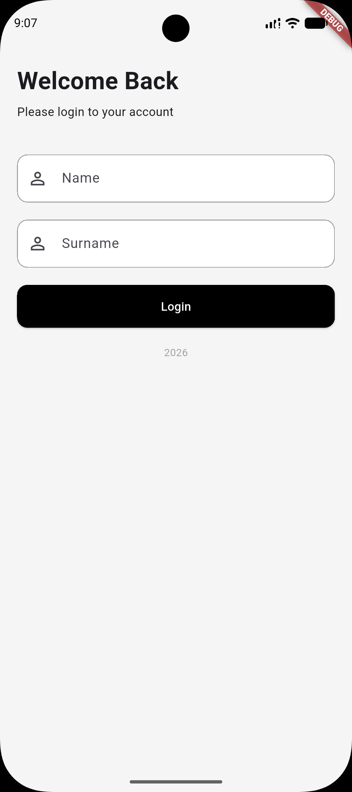
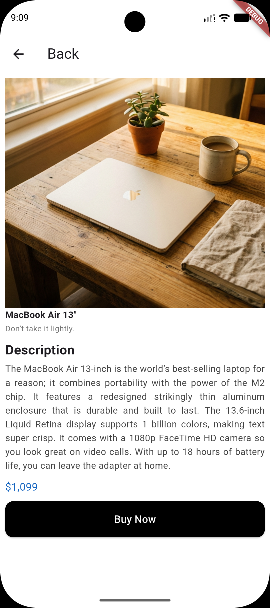
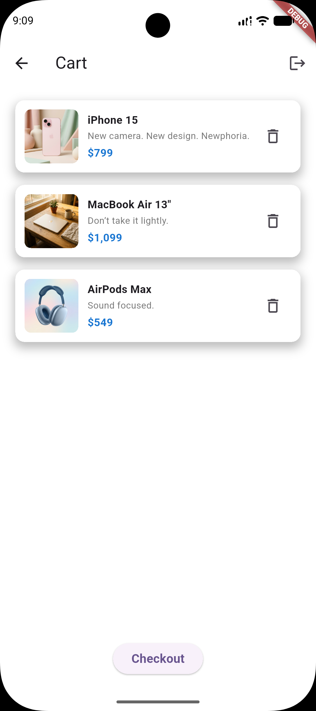
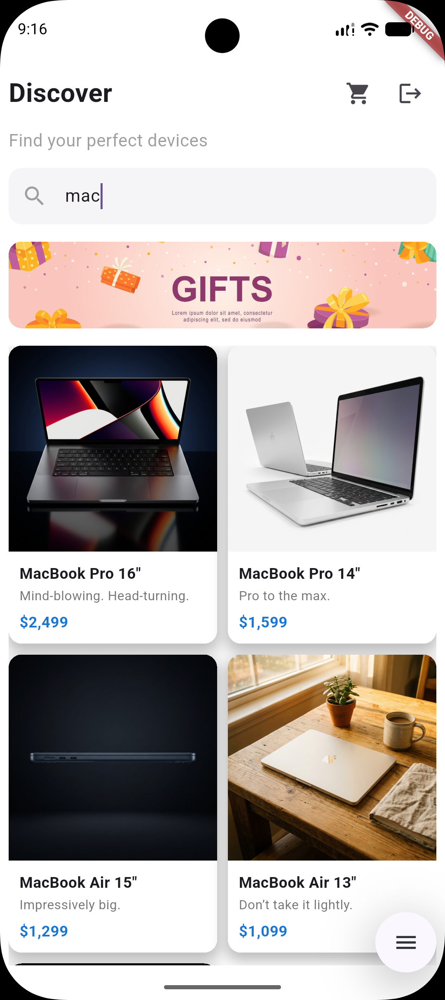

# Mini Katalog Uygulaması

Flutter ile geliştirilmiş, ürünleri listeleyen ve ürünleri sepete eklemeyi sağlayan mini katalog uygulaması.

## Kullanılan Flutter sürümü

Flutter 3.47.8 (stable)  
Dart 3.13.7

## Çalıştırma

1. Depoyu bilgisayarınıza alın.
2. Proje klasöründe `flutter pub get` komutunu çalıştırın.
3. `flutter run` komutuyla uygulamayı başlatın.

## Ekran görüntüleri

